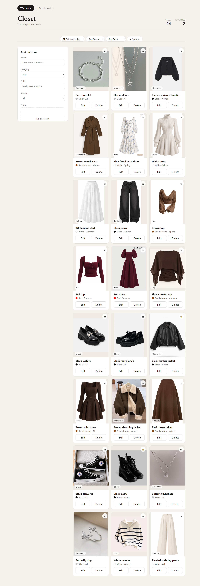
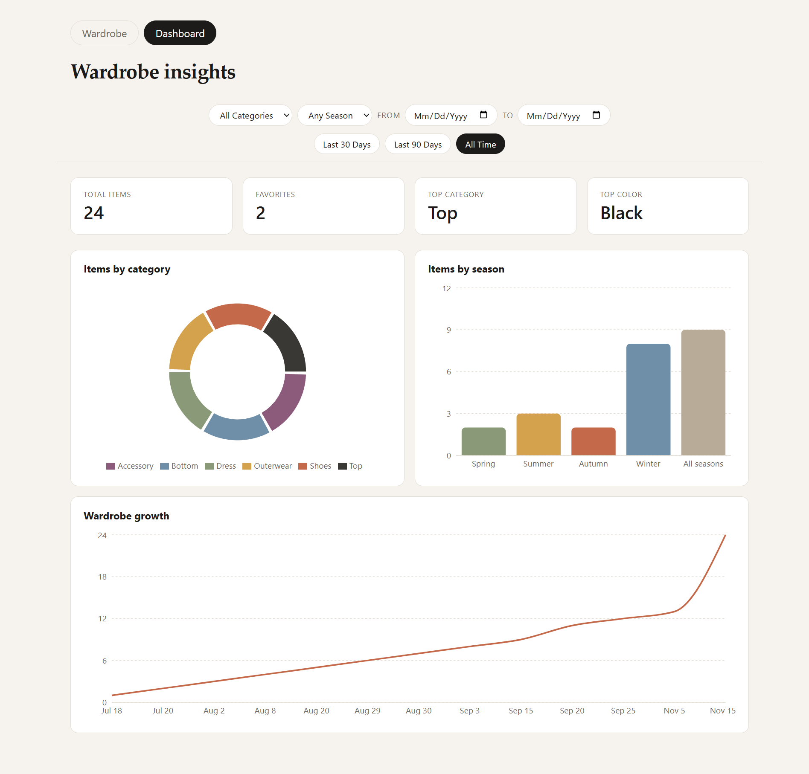
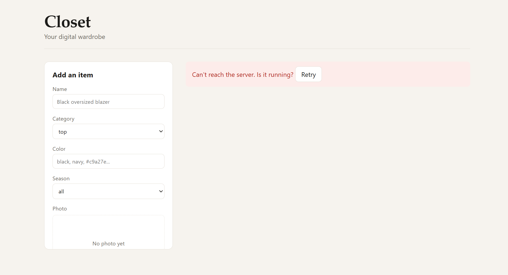

# Closet

A full-stack digital wardrobe. Photograph your clothes, add them to your closet, and browse, filter, edit and delete them from a clean web interface. A dashboard turns the closet into charts so you can see what you own at a glance. The frontend talks to a REST API and a database that are built from scratch in this repository, with no third-party backend involved.

## Features

- Full CRUD on clothing items: create, view, update and delete
- Photo upload from your device, or an image link
- Filtering by category, season and color, plus a favorites-only toggle
- Favorite toggle directly on each card
- Loading and error states on every action:
  - skeleton placeholders while the closet loads, with a retry button if it fails
  - the form disables itself and shows "Saving..." while a request is in flight, and keeps your input if it fails
  - a card dims and shows "Working..." while it is being deleted or favorited
  - clear messages when the server cannot be reached or rejects a request
- Two-step delete confirmation
- Data persisted in a SQLite database, photos persisted on disk
- Responsive layout
- Dashboard view with charts built from live data:
  - stat cards (total pieces, favorites, top category, top color)
  - a donut chart of pieces by category, a bar chart by season, and a line chart of how the closet grew over time
  - interactive filters (category, season, date range and quick presets) that update every chart at once
  - skeleton loaders, an error state with retry, and an empty state when no pieces match

## Screenshots







## Tech stack

**Frontend**

- React 19 with TypeScript
- Vite
- Zustand for global state
- Recharts for the dashboard charts
- Plain CSS (one stylesheet per component, shared design tokens as CSS variables)

**Backend**

- Node.js with Express and TypeScript
- SQLite through `better-sqlite3`
- `multer` for image uploads
- `tsx` for running TypeScript during development

## Project structure

```
Closet/
  client/
    src/
      components/
        dashboard/
          Dashboard.tsx         dashboard page: filters, stat cards and charts
          DashboardFilters.tsx  category, season and date range filters
          StatCard.tsx
          CategoryDonut.tsx
          SeasonBar.tsx
          GrowthLine.tsx
          chartColors.ts        chart palette, matched to the app's design tokens
        EmptyState.tsx
        FilterBar.tsx
        ItemCard.tsx
        ItemForm.tsx
      styles/
      types/
        stats.ts            types for the stats response and dashboard filters
      api.ts                typed API functions and shared error handling
      App.tsx               tab switch between the wardrobe and the dashboard
      dashboardStore.ts     dashboard data, filters and fetching
      itemsStore.ts         item list plus loading and error state
      uiStore.ts            wardrobe filters and the item being edited
      useVisibleItems.ts    applies the wardrobe filters to the item list
      index.css
      main.tsx
      types.ts              shared types, categories and seasons
  server/
    src/
      routes/
        stats.ts            aggregated statistics for the dashboard
      db.ts                 database connection and table definition
      index.ts              Express app setup
      items.ts              CRUD routes and validation
      uploads.ts            image upload route
    uploads/                created automatically, ignored by git
    wardrobe.db             created automatically, ignored by git
```

## Getting started

### Prerequisites

- Node.js 18 or newer (20 or newer recommended)
- npm

### Installation and running

The app runs as two processes, so you need two terminals.

**1. Clone the repository**

```bash
git clone https://github.com/ellie-dhm/Closet.git
cd Closet
```

**2. Start the backend (terminal 1)**

```bash
cd server
npm install
npm run dev
```

The API starts on `http://localhost:3001`. The database file and the `uploads` folder are created automatically on first run. You can check that the server is up by opening `http://localhost:3001/api/health`.

**3. Start the frontend (terminal 2)**

```bash
cd client
npm install
npm run dev
```

Open the URL Vite prints, usually `http://localhost:5173`. Use the **Wardrobe** and **Dashboard** tabs at the top to switch views.

Each person who runs the project gets their own empty closet, because the database and the uploaded photos live on the machine running the server. The dashboard is most interesting once you have added a few dozen pieces with different categories, seasons and colors.

## API reference

Base URL: `http://localhost:3001`

### Items

| Method | Endpoint         | Description     | Success response    |
| ------ | ---------------- | --------------- | ------------------- |
| GET    | `/api/items`     | List all items  | `200` with an array |
| GET    | `/api/items/:id` | Get one item    | `200` with the item |
| POST   | `/api/items`     | Create an item  | `201` with the item |
| PUT    | `/api/items/:id` | Replace an item | `200` with the item |
| DELETE | `/api/items/:id` | Delete an item  | `204` with no body  |

### Stats

| Method | Endpoint     | Description                                                  | Success response          |
| ------ | ------------ | ------------------------------------------------------------ | ------------------------- |
| GET    | `/api/stats` | Aggregated statistics for the dashboard, optionally filtered | `200` with a stats object |

All query parameters are optional and can be combined:

| Parameter  | Description                                                              |
| ---------- | ------------------------------------------------------------------------ |
| `category` | Only count items in this category                                        |
| `season`   | Only count items for this season (items marked `all` match every season) |
| `from`     | Only items added on or after this date (`YYYY-MM-DD`)                    |
| `to`       | Only items added on or before this date (`YYYY-MM-DD`)                   |

Example: `GET /api/stats?season=winter&from=2026-09-01`

Response (`200 OK`):

```json
{
  "summary": {
    "total": 13,
    "favorites": 4,
    "topCategory": "shoes",
    "topColor": "black"
  },
  "byCategory": [{ "name": "shoes", "value": 4 }],
  "bySeason": [{ "name": "winter", "value": 5 }],
  "byColor": [{ "name": "black", "value": 3 }],
  "timeline": [{ "date": "2026-07-18", "value": 1 }]
}
```

Items with no color are grouped under `Unknown`. The `timeline` holds the number of items added per day, and the frontend turns it into a running total.

### Uploads and health

| Method | Endpoint         | Description                                                                                  |
| ------ | ---------------- | -------------------------------------------------------------------------------------------- |
| POST   | `/api/uploads`   | Upload an image (multipart form, field name `image`), returns `{ "url": "/uploads/<file>" }` |
| GET    | `/uploads/:file` | Serves an uploaded image                                                                     |
| GET    | `/api/health`    | Returns `{ "status": "ok" }`                                                                 |

Uploads accept JPG, PNG and WebP files up to 5 MB. Files are stored with a random name, never with the original filename.

### Item fields

| Field        | Type    | Rules                                                                                          |
| ------------ | ------- | ---------------------------------------------------------------------------------------------- |
| `id`         | number  | Generated by the database, read-only                                                           |
| `name`       | string  | Required                                                                                       |
| `category`   | string  | Required. One of `top`, `bottom`, `dress`, `outerwear`, `shoes`, `accessory`, `hijab`, `abaya` |
| `color`      | string  | Optional, free text (a valid CSS color name or hex code also shows a color swatch)             |
| `season`     | string  | One of `spring`, `summer`, `autumn`, `winter`, `all`. Defaults to `all`                        |
| `favorite`   | boolean | Defaults to `false`                                                                            |
| `image_url`  | string  | Required. Either an uploaded path (`/uploads/...`) or an `http(s)` link                        |
| `created_at` | string  | Generated by the database, read-only                                                           |

### Example

Request:

```http
POST /api/items
Content-Type: application/json

{
  "name": "Black oversized blazer",
  "category": "outerwear",
  "color": "black",
  "season": "autumn",
  "favorite": true,
  "image_url": "/uploads/example.jpg"
}
```

Response (`201 Created`):

```json
{
  "id": 1,
  "name": "Black oversized blazer",
  "category": "outerwear",
  "color": "black",
  "season": "autumn",
  "favorite": true,
  "image_url": "/uploads/example.jpg",
  "created_at": "2026-11-04 10:30:00"
}
```

### Errors

Every failure returns a JSON body in the same shape, which the frontend displays directly:

```json
{ "error": "Name is required" }
```

| Status | Meaning                        |
| ------ | ------------------------------ |
| `400`  | Invalid input or an invalid id |
| `404`  | No item with that id           |
| `500`  | Unexpected server error        |

## Design decisions

- **Validation lives on the server.** The API never trusts the request body: it checks every field, restricts categories and seasons to known values, and only accepts uploaded paths or `http(s)` links for images. The database is accessed only through parameterized queries.
- **No optimistic updates.** The interface only changes after the server confirms an action, so what you see is always what is actually saved.
- **One place for state.** Zustand stores own the shared state: `itemsStore` holds the item list and the loading and error state for each kind of action (initial load, saving through the form, and per-item actions), `uiStore` holds the wardrobe filters and the item being edited, and `dashboardStore` holds the dashboard data and its filters. Components stay presentational.
- **One place for network code.** All requests go through a single helper in `api.ts` that turns network failures and server error messages into readable errors.
- **The wardrobe filters in the browser, the dashboard filters on the server.** The full item list is already loaded in the wardrobe, so its filters apply instantly without extra requests. The dashboard asks the server for aggregated numbers instead, so the browser never needs the whole closet to draw a chart. In both views, items marked for `all` seasons match every season filter.
- **The dashboard aggregates in SQL.** Counts are computed with `GROUP BY` and `COUNT` in a single `/api/stats` endpoint, so one request feeds every chart and the browser receives a few small arrays. Filter values are always passed as query parameters, never concatenated into SQL.
- **Stale responses are ignored.** If the dashboard filters change while a request is in flight, only the latest response updates the charts, so a slow response can never overwrite a newer one.
- **Fresh data on every visit.** The dashboard refetches whenever it is opened, so changes made in the Wardrobe tab show up immediately.
- **Dashboard states reuse the wardrobe patterns.** Skeletons while loading, an error banner with retry, and the shared empty state with a "Clear filters" action. The filters stay visible in every state, so you can never get stuck on an empty dashboard.
- **Chart colors live in one file** (`chartColors.ts`), chosen to match the app's palette. The season chart uses a color per season so the bars read at a glance.
- **Photos are uploaded first, then referenced.** The upload endpoint returns a path, and that path is stored on the item, so the item endpoints stay simple JSON.

## Limitations

- There are no user accounts: the app is single-user, and anyone with access to the running server can view and change its data.
- The API address (`http://localhost:3001`) is set in `client/src/api.ts` and is not yet configurable by environment.
- Deleting an item does not delete its uploaded photo from disk.
- The date filter and the growth chart use the date a piece was added to the closet, not when it was bought or last worn.
- Statistics are recalculated on every request. That is fine for a personal closet, but a very large dataset would need caching or indexes.

## Future improvements

- **Authentication and per-user closets.** Registration and login with hashed passwords, a `user_id` on every item, and server-side checks so each user can only read and change their own data. Uploaded photos would be protected the same way.
- **Deployment.** Environment-based configuration for the API address, persistent storage for the database, and cloud object storage for photos.
- **AI features.** An agent that suggests outfits from the items in the closet, tags clothing automatically from a photo, and recommends what to wear for the season or the weather.
- **Wear tracking and insights.** Log when each piece is worn to chart the most and least worn items and the cost per wear.
- **Dashboard drill-downs.** Click a slice or a bar to filter by it, compare periods, and export the dashboard data as CSV.
- **Outfit builder.** Combine pieces into saved outfits and plan them on a calendar.
- **Image handling.** Resize and compress photos on upload, and remove orphaned files when an item is deleted or its photo is replaced.
- **Search, sorting and pagination.** Text search by name, sort options, and server-side pagination for large closets.
- **Automated tests.** API tests for the endpoints and validation, and component tests for the form, filters and stats aggregation.
- **Accessibility pass.** Full keyboard and screen reader review of the form, cards, filters and charts.
