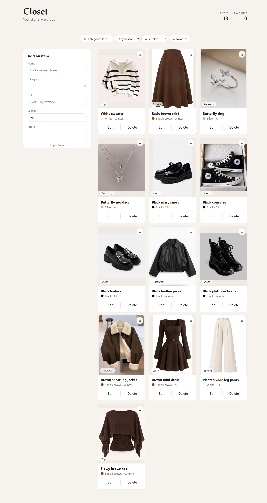
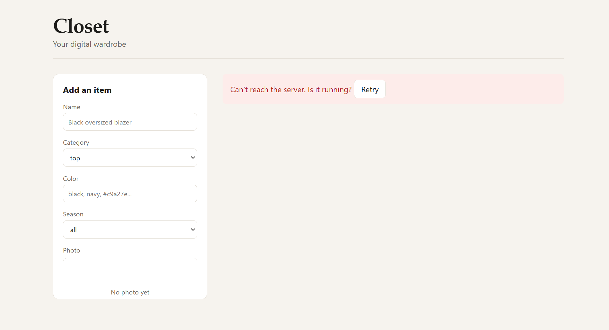

# Closet

A full-stack digital wardrobe. Photograph your clothes, add them to your closet, and browse, filter, edit and delete them from a clean web interface. The frontend talks to a REST API and a database that are built from scratch in this repository, with no third-party backend involved.

## Features

- Full CRUD on clothing items: create, view, update and delete
- Photo upload from your device, or an image link
- Filtering by category, season and color, plus a favorites-only toggle
- Favorite toggle directly on each card
- Loading and error states on every action:
  - skeleton placeholders while the closet loads, with a retry button if it fails
  - the form disables itself and shows "Saving..." while a request is in flight, and keeps your input if it fails
  - a card dims and shows "Working..." while it is being deleted or favorited
  - clear messages when the server cannot be reached or rejects a request
- Two-step delete confirmation
- Data persisted in a SQLite database, photos persisted on disk
- Responsive layout

## Screenshots





## Tech stack

**Frontend**

- React 19 with TypeScript
- Vite
- Plain CSS (one stylesheet per component, shared design tokens as CSS variables)

**Backend**

- Node.js with Express and TypeScript
- SQLite through `better-sqlite3`
- `multer` for image uploads
- `tsx` for running TypeScript during development

## Project structure

```
Closet/
  client/
    src/
      components/
        FilterBar.tsx
        ItemCard.tsx
        ItemForm.tsx
      styles/
      api.ts            typed API functions and shared error handling
      App.tsx
      index.css
      main.tsx
      types.ts          shared types, categories and seasons
      useItems.ts       state management hook
  server/
    src/
      db.ts             database connection and table definition
      index.ts          Express app setup
      items.ts          CRUD routes and validation
      uploads.ts        image upload route
    uploads/            created automatically, ignored by git
    wardrobe.db         created automatically, ignored by git
```

## Getting started

### Prerequisites

- Node.js 18 or newer (20 or newer recommended)
- npm

### Installation and running

The app runs as two processes, so you need two terminals.

**1. Clone the repository**

```bash
git clone https://github.com/ellie-dhm/closet.git
cd closet
```

**2. Start the backend (terminal 1)**

```bash
cd server
npm install
npm run dev
```

The API starts on `http://localhost:3001`. The database file and the `uploads` folder are created automatically on first run. You can check that the server is up by opening `http://localhost:3001/api/health`.

**3. Start the frontend (terminal 2)**

```bash
cd client
npm install
npm run dev
```

Open the URL Vite prints, usually `http://localhost:5173`.

Each person who runs the project gets their own empty closet, because the database and the uploaded photos live on the machine running the server.

## API reference

Base URL: `http://localhost:3001`

### Items

| Method | Endpoint         | Description     | Success response    |
| ------ | ---------------- | --------------- | ------------------- |
| GET    | `/api/items`     | List all items  | `200` with an array |
| GET    | `/api/items/:id` | Get one item    | `200` with the item |
| POST   | `/api/items`     | Create an item  | `201` with the item |
| PUT    | `/api/items/:id` | Replace an item | `200` with the item |
| DELETE | `/api/items/:id` | Delete an item  | `204` with no body  |

### Uploads and health

| Method | Endpoint         | Description                                                                                  |
| ------ | ---------------- | -------------------------------------------------------------------------------------------- |
| POST   | `/api/uploads`   | Upload an image (multipart form, field name `image`), returns `{ "url": "/uploads/<file>" }` |
| GET    | `/uploads/:file` | Serves an uploaded image                                                                     |
| GET    | `/api/health`    | Returns `{ "status": "ok" }`                                                                 |

Uploads accept JPG, PNG and WebP files up to 5 MB. Files are stored with a random name, never with the original filename.

### Item fields

| Field        | Type    | Rules                                                                                          |
| ------------ | ------- | ---------------------------------------------------------------------------------------------- |
| `id`         | number  | Generated by the database, read-only                                                           |
| `name`       | string  | Required                                                                                       |
| `category`   | string  | Required. One of `top`, `bottom`, `dress`, `outerwear`, `shoes`, `accessory`, `hijab`, `abaya` |
| `color`      | string  | Optional, free text (a valid CSS color name or hex code also shows a color swatch)             |
| `season`     | string  | One of `spring`, `summer`, `autumn`, `winter`, `all`. Defaults to `all`                        |
| `favorite`   | boolean | Defaults to `false`                                                                            |
| `image_url`  | string  | Required. Either an uploaded path (`/uploads/...`) or an `http(s)` link                        |
| `created_at` | string  | Generated by the database, read-only                                                           |

### Example

Request:

```http
POST /api/items
Content-Type: application/json

{
  "name": "Black oversized blazer",
  "category": "outerwear",
  "color": "black",
  "season": "autumn",
  "favorite": true,
  "image_url": "/uploads/example.jpg"
}
```

Response (`201 Created`):

```json
{
  "id": 1,
  "name": "Black oversized blazer",
  "category": "outerwear",
  "color": "black",
  "season": "autumn",
  "favorite": true,
  "image_url": "/uploads/example.jpg",
  "created_at": "2026-11-04 10:30:00"
}
```

### Errors

Every failure returns a JSON body in the same shape, which the frontend displays directly:

```json
{ "error": "Name is required" }
```

| Status | Meaning                        |
| ------ | ------------------------------ |
| `400`  | Invalid input or an invalid id |
| `404`  | No item with that id           |
| `500`  | Unexpected server error        |

## Design decisions

- **Validation lives on the server.** The API never trusts the request body: it checks every field, restricts categories and seasons to known values, and only accepts uploaded paths or `http(s)` links for images. The database is accessed only through parameterized queries.
- **No optimistic updates.** The interface only changes after the server confirms an action, so what you see is always what is actually saved.
- **One place for state.** The `useItems` hook owns the item list and the loading and error state for each kind of action (initial load, saving through the form, and per-item actions). Components stay presentational.
- **One place for network code.** All requests go through a single helper in `api.ts` that turns network failures and server error messages into readable errors.
- **Filtering happens in the browser.** The full list is already loaded, so filters apply instantly without extra requests. Items marked for `all` seasons match every season filter.
- **Photos are uploaded first, then referenced.** The upload endpoint returns a path, and that path is stored on the item, so the item endpoints stay simple JSON.

## Limitations

- There are no user accounts: the app is single-user, and anyone with access to the running server can view and change its data.
- The API address (`http://localhost:3001`) is set in `client/src/api.ts` and is not yet configurable by environment.
- Deleting an item does not delete its uploaded photo from disk.

## Future improvements

- **Authentication and per-user closets.** Registration and login with hashed passwords, a `user_id` on every item, and server-side checks so each user can only read and change their own data. Uploaded photos would be protected the same way.
- **Deployment.** Environment-based configuration for the API address, persistent storage for the database, and cloud object storage for photos.
- **AI features.** An agent that suggests outfits from the items in the closet, tags clothing automatically from a photo, and recommends what to wear for the season or the weather.
- **Outfit builder.** Combine pieces into saved outfits and plan them on a calendar.
- **Image handling.** Resize and compress photos on upload, and remove orphaned files when an item is deleted or its photo is replaced.
- **Search, sorting and pagination.** Text search by name, sort options, and server-side pagination for large closets.
- **Automated tests.** API tests for the endpoints and validation, and component tests for the form and filters.
- **Accessibility pass.** Full keyboard and screen reader review of the form, cards and filters.
